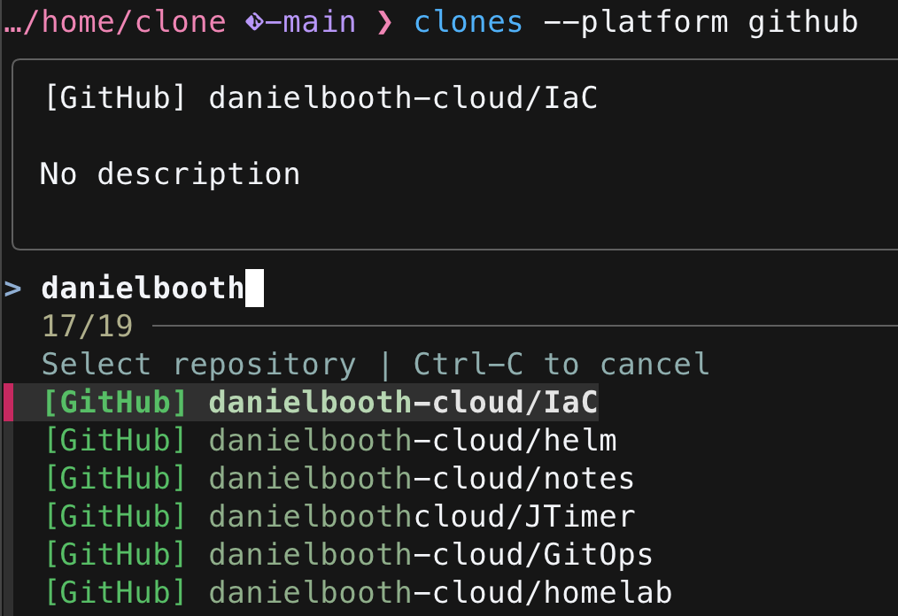

# clones

Interactive CLI for cloning and managing Git repos from GitHub and GitLab. Uses `fzf` for fuzzy finding, NutsDB for caching, and optional Jira integration for ticket labels.



## Install

```bash
go install github.com/danielboothcloud/clones@latest
```

Or build from source:

```bash
go build -o ~/.local/bin/clones .
```

Requires `fzf`, `git`, and auth via `gh auth login` / `glab auth login` (or `GITHUB_TOKEN` / `GITLAB_TOKEN` env vars).

## Shell Wrapper

The binary outputs a directory path to stdout — the shell wrapper captures it to auto-cd and open your editor. Add this function to `~/.zshrc` or `~/.bashrc`:

```bash
clones() {
  local target_dir
  target_dir=$(command clones "$@")
  local exit_code=$?

  if [[ $target_dir == EDIT:* ]]; then
    local repo_path="${target_dir#EDIT:}"
    if [[ -d "$repo_path" ]]; then
      cd "$repo_path" || return 1
      ${EDITOR:-vi} .
    fi
    return
  fi

  if [[ $exit_code -eq 0 && -d "$target_dir" ]]; then
    cd "$target_dir" || return 1
  fi
}
```

## Usage

```bash
clones                       # browse all repos (remote + local)
clones terraform             # filter by name
clones -l                    # local repos only (cd, pull, push, delete, edit)
clones -r                    # remote repos only
clones --platform gitlab     # single platform
clones --no-cache            # force a local rescan and fresh remote API data
clones --version             # show version (sourced from the VERSION file)
clones --jira                # only repos with active Jira tickets
```

Repos clone to `~/projects/<owner>/<repo>` by default (configurable — see Settings).

## Settings

Optional. Create `~/.config/clones/clones.yml`:

```yaml
github_host: github.com           # GitHub Enterprise: ghe.example.com
gitlab_host: gitlab.com           # self-hosted GitLab: gitlab.example.com
clone_protocol: ssh               # ssh or https
clone_root: ~/projects            # where repos are cloned

# Optional: run heavy git ops on a remote host (useful when clone_root
# lives on a fuse-t / sshfs / NFS mount that struggles with pack churn).
remote:
  host: bluefin-vm                # ssh alias (must be in ~/.ssh/config or resolvable)
  path: /var/home/you/projects    # absolute path on the remote that backs clone_root
  ops:                            # which ops to dispatch via SSH
    - clone
    - delete
    - pull
    - push
    - checkout
  sync_timeout_seconds: 5         # how long to wait for the local mount to see remote changes
```

Env var overrides: `GITHUB_HOST`, `GITLAB_HOST`, `CLONES_PROTOCOL`, `CLONES_ROOT`.

When `remote:` is configured, ops listed in `ops:` execute via `ssh <host> <cmd>` instead of locally. Read-only ops (`cd`, `edit`, `jiraopen`, `jirastatus`) always run locally.

## Cache

Remote repos are cached in NutsDB at `~/.cache/clones/db/` with 24h TTL. Stale cache is served instantly while a background refresh runs for next time.

Local repos (including branch, dirty/unpushed indicators, and Jira labels) are snapshotted
in the same NutsDB database and served instantly on every run — there is no hard expiry
(serve-stale). Runs spaced more than a minute apart serve the snapshot immediately and
rescan in the background for the next run; rapid consecutive runs skip the rescan
entirely. Filters are applied to the snapshot, so changing the search or platform
never triggers a rescan.

The scan itself is a leaf-walk: any directory containing `.git` is a repo and a leaf —
its contents are never traversed. On a real clone root this cut the walk from ~62,000
directories (13.6s, two-thirds of them node_modules) to a few hundred (~12ms). Repos
nested inside other repos and known bulk dirs (node_modules, .venv, target, …) outside
repos are ignored.

A clone-root or Jira config change, and clone/pull/push/checkout/delete operations
performed by `clones`, invalidate the snapshot immediately. An epoch counter voids
any in-flight background refresh in the same transaction, so a scan racing a delete
can never resurrect the deleted repo. If another `clones` launch holds the database
at the moment of invalidation, it retries briefly and then warns loudly — with no TTL
as backstop, the warning means the stale snapshot keeps being served until the next
successful invalidation. Changes made outside `clones` appear on the run after the
background refresh lands; use `clones -l --no-cache` for an immediate guaranteed-fresh
rescan.

Jira JQL results (the summaries and statuses backing `[PROJ-123: In Progress]` labels)
are persisted in the same database with a 1-hour TTL, so a fresh `clones` process
usually talks to Atlassian at most once an hour; `--no-cache` busts this cache too.
Jira labels in listings can therefore lag reality by up to one hour.

## Exclude Patterns

Create `~/.config/clones/exclude.txt` to hide repos from results. One pattern per line, matched against `owner/name`, `platform/owner/name`, and description. Lines starting with `#` are comments.

```
archived
/deprecated/
some-org/old-project
```

## Jira Integration

Optional. Configure `~/.config/clones/jira.yml`:

```yaml
enabled: true
base_url: https://yourorg.atlassian.net
email: you@example.com
jql: assignee = currentUser() AND status not in (Closed, Done, Completed)
active_statuses: In Progress, In Review, To Do, Pending
```

When enabled, local repos show Jira ticket labels extracted from branch names (e.g. `feature/PROJ-123` shows `[PROJ-123]`). The JQL filter controls which tickets are displayed. Set `enabled: false` or remove the file to disable. JQL results are cached in NutsDB for one hour — labels can lag reality by up to that window; `--no-cache` forces a live fetch.

## Version

The version lives in the root `VERSION` file and is embedded into the binary at build
time (`clones --version`). To release: update `VERSION`, commit, then tag
(the installed binary reports the version it was built from).

## License

MIT
